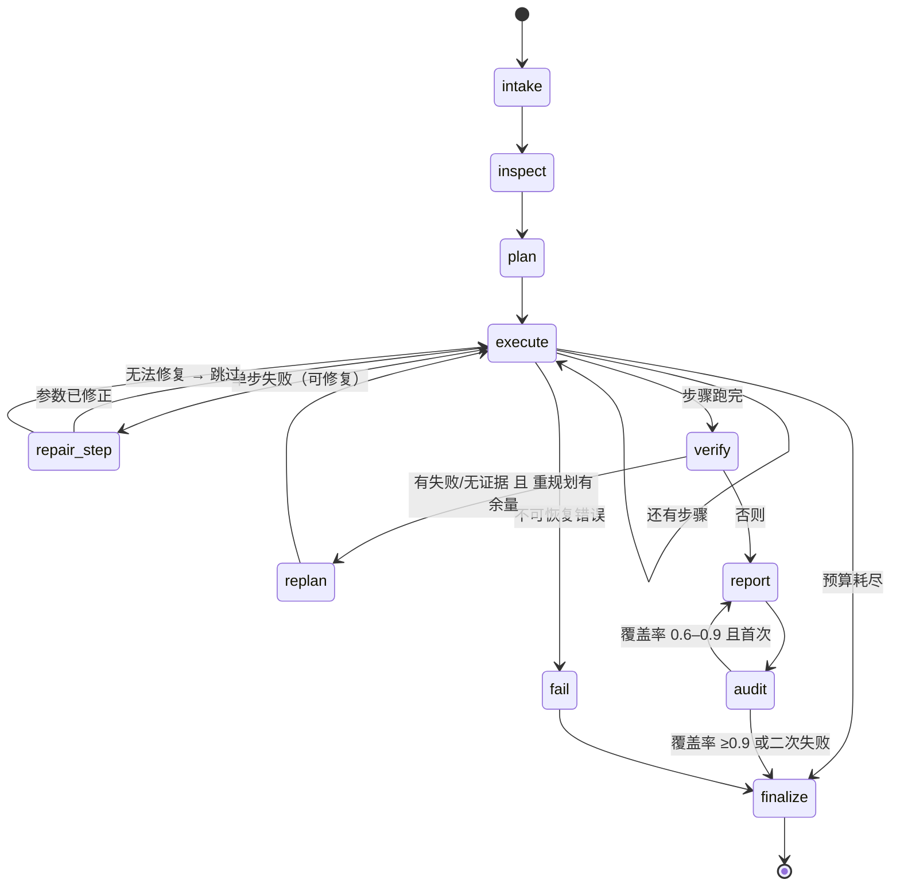

# MetricMind

**计划先行、受控工具计算、证据链与数字审计的 AI 数据分析工作台。**
用自然语言提一个分析问题，Agent 先给出结构化计划，再逐步调用受控工具做确定性计算，
最后生成一份**每个数字都能回溯到具体工具执行结果**的可视化报告。

- **计划可见**：分析计划（步骤 / 工具 / 预期输出 / 验证方式）在执行前就展示给用户。
- **计算受控**：7 个工具的参数经 Pydantic 校验，SQL 过 sqlglot 只读守卫，模型不执行任意代码。
- **数字可审**：每次工具调用产出 `result_id`，报告结论绑定证据；独立审计器逐条核对数字。
- **导出可离线**：HTML 报告是完全自包含单文件（内联 CSS + 内联 SVG，无外链无 JS）。


---

## 1. Demo Mode 与 Live 模式

| | **Live 模式** | **Demo 模式** |
|---|---|---|
| 是否需要大模型 | 需要（任意 OpenAI 兼容服务） | 不需要 |
| 计划来源 | LLM 产出 `StructuredPlan`（JSON Schema 严格模式 + 1 次修复重试） | `demo_planner` 按字段结构确定性生成 |
| 报告叙述来源 | LLM 基于证据池撰写 | 模板排版（只读取证据里的数字，不做算术） |
| 工具执行 | 完全真实（DuckDB / pandas） | 完全真实（同一套工具） |
| 可复现性 | 受模型采样影响 | 同一数据集同一问题两次运行完全一致（时间戳除外） |
| 适用场景 | 演示模型能力、自由提问 | CI、无 Key 环境、稳定复现 |

首页可以选择 **自动 / Live / Demo**；选 Live 但没配 Key 时会给出说明，并提供「改用 Demo 重试」按钮。`POST /api/runs` 若显式请求 `live` 会返回 `409 LLM_NOT_CONFIGURED`；
`auto`（默认）会自动落到 Demo。`/api/health` 与 `/api/config` 会如实返回当前模式。

---

## 2. 快速开始

**环境要求**：Python ≥ 3.11（已验证 3.12.14）、Node.js ≥ 18（已验证 24.21.0）、pnpm 11。
走 Docker 则只需要 Docker Desktop / Docker Engine + Compose v2.24+。

### 一键启动（Windows，推荐）

```powershell
# 在仓库根目录（D:\work\MetricMind）执行，不要先 cd backend
.\scripts\dev.cmd
```

脚本会：优先用 `backend\.venv\Scripts\python.exe` 起后端（8000）、用 Node 起 Vite（5173）；
端口已健康则跳过；端口被别的进程占用时直接告诉你原因（uvicorn 的 `Aborted!` 就是端口被占）；
日志写到 `.dev-logs\`，停止用 `.\scripts\dev.cmd -Stop`。

> 只装了 Node 但没装 pnpm 也能用：脚本会直接调用 `frontend\node_modules\vite\bin\vite.js`（依赖已装好的前提下）。

### 一键启动（Docker，任意平台）

```powershell
# 仓库根执行；没有 .env 也能跑（Demo 模式），填了 Key 就是 Live
Copy-Item .env.example .env      # 可选
docker compose up -d --build
```

打开 **http://localhost:8080**。web 容器用 Nginx 托管前端并反代 `/api`，api 容器只在本机 18000 暴露 `/docs`
（避开本地 dev 后端的 8000）；数据落在 `metricmind_data` 卷里，重建镜像不丢。端口调整、冒烟命令、排错与
「为什么只能单 worker」见 [docs/DOCKER.md](docs/DOCKER.md)。

### 手动启动（两个终端，各自从仓库根开始）

```powershell
# 终端 1 —— 后端（必须用 venv 里的 python，或先激活 venv）
cd D:\work\MetricMind\backend
.\.venv\Scripts\Activate.ps1          # 激活后 python 才带 FastAPI/uvicorn
python -m uvicorn app.main:app --reload --port 8000

# 终端 2 —— 前端（注意是 frontend，不是 backend\frontend）
cd D:\work\MetricMind\frontend
pnpm dev                              # 或 npm run dev
```

**常见启动错误对照**

| 现象 | 原因 | 处理 |
|---|---|---|
| 后端只输出 `Aborted!` | 端口 8000 已被占用（常见于已有一个实例在跑） | `.\scripts\dev.ps1 -Stop`，或 `netstat -ano \| findstr :8000` 找 PID 后结束 |
| `cd : 找不到路径 ...\backend\frontend` | 当前目录还在 `backend` | 两个服务分别在 `backend\` 与 `frontend\`，从仓库根分别 `cd` |
| `pnpm : 无法将“pnpm”项识别为...` | 本机没装 Node/pnpm | 装 Node 18+（含 npm），再 `npm i -g pnpm`；或直接跑 `.\scripts\dev.cmd` |
| `No module named uvicorn` | 用的是系统 Python，不是 venv | 激活 `.venv` 或用 `.\.venv\Scripts\python.exe -m uvicorn ...` |

### macOS / Linux Bash

```bash
cd backend
python3 -m venv .venv && source .venv/bin/activate
pip install -r requirements.txt
python -m uvicorn app.main:app --reload --port 8000

cd ../frontend
pnpm install
pnpm dev
```

打开 **http://127.0.0.1:5173**（前端，`/api` 代理到 8000），后端文档在 **http://127.0.0.1:8000/docs**。

示例数据需要生成一次（已提交到 `data/`，如被清空可重建）：

```bash
python scripts/generate_sample_data.py     # 固定 seed，两次运行 sha256 一致
python scripts/compute_expected.py         # 纯 pandas 金标准 → data/expected_answers.json
python scripts/build_olist_sample.py       # Olist 公开数据 → data/sample_olist_orders.csv
```

> Olist 原始 CSV 放在 `data/olist_raw/`（约 50MB，不入库）；产物为 **112,650 行 / 15 列 / 14.5MB**，
> 是真实公开数据（Olist Brazilian E-Commerce，CC BY-NC-SA 4.0），不含任何用户隐私字段。

### 配置（`.env`）

`.env` **不会**被提交（在 `.gitignore` 里），仓库里只有 `.env.example`。第一次使用需要复制一份：

```powershell
# 仓库根执行：生成 D:\work\MetricMind\.env
Copy-Item .env.example .env
```

```bash
# macOS / Linux
cp .env.example .env
```

也可以放在 `backend\.env`（后端同时读仓库根 `.env` 与 `backend\.env`，后者优先）。
**不填也能跑 Demo 模式**；只有想用 Live 才需要填 `OPENAI_API_KEY`。
改完 `.env` 必须**重启后端**才生效，然后用 `GET /api/health` 或首页右上角徽标确认 `llm_mode` 变成 `live`。

| 变量 | 默认 | 说明 |
|---|---|---|
| `OPENAI_API_KEY` | 空 | 为空即 Demo 模式 |
| `OPENAI_BASE_URL` | `https://api.openai.com/v1` | 任意兼容服务（DeepSeek / Moonshot / vLLM…） |
| `LLM_MODEL` | `gpt-4o-mini` | 不硬编码模型名 |
| `LLM_MODE` | `auto` | `auto` / `live` / `demo` |
| `MAX_STEPS` / `MAX_TOOL_CALLS` / `MAX_REPLANS` | 10 / 16 / 2 | 单次运行预算 |
| `RUN_TIMEOUT_S` | 240 | 单次运行超时 |
| `MAX_UPLOAD_MB` / `MAX_ROWS` | 25 / 200000 | 上传限制 |

---

## 3. 5 分钟演示路径

1. **首页** → 点「Olist 电商订单（真实公开数据）」（112,650 行 / 15 列，载入幂等）。
2. 输入 **“为什么 2018 年 8 月销售额相比 7 月下降了？”** → 开始分析。
3. **工作区**：先看到计划（5 步，含工具与验证方式），步骤逐个变成「完成」，右栏执行流实时推事件。
4. 展开任意步骤 → 工具卡「参数 / 结果」两个 Tab；点 `result_id` 可复制，粘贴到 `GET /api/tools`…
   实际上用 `GET /api/runs/{id}` 能查到同一结果集。
5. 看 KPI（当月销售额、环比降幅）、月度趋势图（「查看数据」抽屉里是同一份表格）。
6. **报告**：结论 + 证据编号、数字核验（声称值 → 证据值）、方法论口径、数据质量、局限性。
7. **导出 HTML** → 下载后断网打开，样式与图表完整（内联 SVG）。

完整脚本（7 个节拍、每步说什么、屏幕上应出现什么）见 `docs/DEMO_SCRIPT.md`。

---

## 4. 架构

```mermaid
flowchart LR
  B[浏览器 React 18 + Vite] -- REST /api --> F[FastAPI]
  B -. SSE /events/stream .-> F
  F --> R[Runner<br/>Semaphore(2) · 取消 · 超时]
  R --> G[LangGraph StateGraph]
  G --> N[intake → inspect → plan → execute → verify → report → audit → finalize]
  N --> T[7 个受控工具]
  T --> D[(DuckDB in-memory<br/>视图 data)]
  T --> P[pandas 指标 / 图表]
  R --> S[(SQLite<br/>datasets/runs/events/results/artifacts)]
  R --> FS[data/uploads · data/exports]
  R -. 事件 .-> BUS[进程内 EventBus]
  BUS --> F
```

- 请求线程只负责落库与返回；**运行由后台 task 持有**，客户端断开不取消运行。
- 事件以 SQLite 为准（`after_seq` 续播），总线只负责“实时”这一层。
- 工具执行与证据池强绑定：`result_id` 只对产出数据/图表的工具存在。

---

## 5. Agent 工作流



预算：10 步 / 16 次工具调用 / 2 次重规划 / 240s；任一项耗尽 → `budget_warning` + `partial`。
节点细节、提示词全文与失败降级路径见 `docs/AGENT_WORKFLOW.md`。

---

## 6. 七个工具

| 工具 | 用途 | 关键参数 | 安全 / 预算限制 | 产出 result_id |
|---|---|---|---|---|
| `inspect_dataset` | 字段探查：类型、语义、缺失、样例、时间范围 | `dataset_id, sample_rows≤5` | 每 run ≤2 次 | 是 |
| `profile_dataset` | 质量剖析：空值/唯一值/极值/P95/异常值 + 8 类问题码 | `dataset_id, columns?, include_outliers` | 每 run ≤2 次 | 是 |
| `query_data` | 只读 SQL（视图 `data`） | `sql≤4000, max_rows≤500` | sqlglot AST 守卫 + DuckDB 禁外部访问；≤6 次 | 是 |
| `calculate_metrics` | 11 种确定性指标 | `metrics[]`（kind/column/group_by/filters…） | pandas 计算，除零返回 null+warning；≤8 次 | 是 |
| `create_chart` | 由结果集生成 `ChartSpec` | `from_result_id, type, x, y, series?` | 必须引用真实 `result_id`，列必须存在；≤5 次 | 是 |
| `verify_result` | 数字溯源审计 | `claims[]`（含 numbers/evidence_ids） | 只读证据池；≤3 次 | 否 |
| `export_report` | 导出自包含 HTML / Markdown | `run_id, format` | 仅运行结束后可用；≤2 次 | 否 |

完整 schema、示例调用与错误码见 `docs/TOOLS.md`。

---

## 7. 数据真实性：四道程序化关卡

| 关卡 | 实现位置 | 作用 |
|---|---|---|
| 1. 模型不接触原始数据 | `agent/nodes/inspect.py` → `agent/nodes/plan.py::_plan_payload` | 只给字段摘要与样例值（≤3/列），不给 DataFrame |
| 2. 图表只能引用结果集 | `agent/tools/create_chart.py` + `services/charts.py::build_chart_spec` | 只接受 `from_result_id`，列名必须真实存在，无数据数组入口 |
| 3. 报告数字逐条审计 | `agent/nodes/audit.py` + `services/verifier.py::verify_claims` | 每个 claim 的每个数字与证据比对，0.5% 容差；未通过 → 降级进 limitations |
| 4. 渲染值以证据为准 | `services/report_builder.py::build_report` | KPI/claim 的展示值用证据值重新格式化，保留 `claimed_value` 供前端对比 |

另有代码级保障：`services/sql_guard.py`（AST 白名单 + 表名 `data` + 函数黑名单）、
`services/engine.py`（`enable_external_access=false` + 禁自动加载扩展）。

---

## 8. 测试与评测（真实执行结果）

```bash
cd backend
python -m pytest -q                     # 141 passed in 27.75s
python -m evals.run --mode mock         # 9/9 (100.0%)；评测使用独立数据目录 backend/data/evals

cd frontend
npx tsc --noEmit                        # 通过
pnpm test -- --run                      # 31 passed in 2.20s
pnpm build                              # 通过（index 116.4kB / charts 407.6kB / css 30.7kB）
pnpm e2e                                # 3 passed（含真实 HTML 下载、非法上传、Live 未配置）
```

| 套件 | 结果 | 覆盖重点 |
|---|---|---|
| 后端 pytest | **141 passed** | SQL 守卫 39、工具、指标、loader、API、导出、验证器、事件、重规划、取消、确定性 |
| 评测（mock） | **9/9（100%）** | 归因 / 结构 / 对比 / 质量 / 不可答 / 越权 / 漏斗转化 / 漏斗收入 / 地区结构 |
| 前端 vitest | **31 passed**（2.20s） | 五状态时间线、工具卡错误态、KPI 格式化、上传校验、partial 横幅、SSE 去重与降级 |
| E2E（Chromium） | **3 passed**（9.0s） | 主线（计划/工具/图表/报告/导出下载）+ 非法上传 + Live 未配置提示 |

`backend/evals/last_run.md` 是评测运行产物（含逐例工具链、覆盖率、未通过项）。
**mock 与 live 的区别**：mock 衡量确定性分析链（工具数值、证据完整性）；模型理解力需要 `--mode live`。
2026-10-24 在 112,650 行 Olist 数据上跑过一次 live 端到端：12 次工具调用、68s、
证据覆盖率 100%、0 条未支持结论（见 `scripts/run_olist_live.py`）。

---

## 9. 项目结构

```text
MetricMind/
├── backend/
│   ├── app/
│   │   ├── main.py               # FastAPI 装配：中间件、错误信封、lifespan 自检
│   │   ├── config.py             # 唯一配置入口（pydantic-settings）
│   │   ├── errors.py             # ErrorCode + AppError + 统一信封
│   │   ├── runner.py             # 后台任务、并发、取消、超时
│   │   ├── api/                  # datasets / runs / events / system
│   │   ├── models/               # 领域模型 + SSE 事件契约
│   │   ├── services/             # loader / engine / sql_guard / metrics / evidence /
│   │   │                         # verifier / charts / report_builder / exporter / store
│   │   ├── llm/                  # Protocol + OpenAI 客户端 + Fake + prompts/*.md
│   │   ├── agent/                # state / run_context / graph / nodes / tools / demo_planner
│   │   └── templates/            # 导出用 Jinja2 模板（HTML / Markdown）
│   ├── evals/                    # cases.json + run.py + last_run.md
│   └── tests/                    # pytest（125 例）
├── frontend/
│   ├── src/components/{app,agent,dataset,result,report,feedback,ui}
│   ├── src/pages/                # Home / Workspace / Report / NotFound
│   ├── src/hooks/                # useRun / useRunStream / useDatasets …
│   └── tests/                    # vitest + e2e/mainline.spec.ts
├── data/                         # 示例 CSV + samples.json + expected_answers.json
├── scripts/                      # generate_sample_data.py / compute_expected.py
├── deploy/nginx.conf             # 容器内 Nginx：SPA 回退 + /api 反代 + SSE 不缓冲
├── docker-compose.yml            # web + api 两个服务
└── docs/                         # ARCHITECTURE / AGENT_WORKFLOW / TOOLS / API /
                                  # DEMO_SCRIPT / INTERVIEW_QA / DECISIONS / DOCKER
```

---

## 10. 已知限制（如实列出）

- **单表数据集**：一次分析只针对一个 CSV/XLSX，不做多表 join；超过 60 列或 20 万行会被拒绝。
- **无多轮对话**：不做长对话记忆，改动问题等于新建一次运行（计划会被重新生成）。
- **无权限体系**：无登录、多租户、计费；接口按 IP 做 6 次/分钟限流、全局并发 2。
- **SQL 守卫是白名单不是沙箱**：基于 sqlglot AST + DuckDB 执行隔离，不是操作系统级沙箱。
- **Demo 模式的叙述是模板**：与问题措辞无关（计划由字段结构决定），所以 Demo 更适合演示“流程与数字可信”，
  而不是“模型理解力”。这一点在评测报告里也标注了。
- **未接入的知识**：不解析 PDF/Word、不做 OCR/网页抓取、不连实时数据库。
- **Live 只跑了单例**：在 112,650 行 Olist 数据上跑通一次 live 端到端（68s、12 次工具调用、覆盖率 100%），
  但没有做 live 批量评测，模型理解力的稳定性还没有数字。
- **评测规模小**：9 条金标准场景，只能证明典型路径正确，不能证明泛化能力。
- **前端 E2E 3 条**：主线 + 非法上传 + Live 未配置；取消与断网降级仍只由单测覆盖。
- **开发环境注意**：在受限 Windows 沙箱里 `python -m venv` 可能缺少 pip（`ensurepip` 失败），
  可改用 `python -m venv --without-pip` + 基础解释器的 `pip --python <venv>\Scripts\python.exe install -r requirements.txt`。

---

## 11. 设计取舍

| 选择 | 为什么不选替代方案 |
|---|---|
| **LangGraph `StateGraph`** | 需要“有状态、可条件路由、可重规划”的单工作流；AutoGen/CrewAI 的多 Agent 互评会带来不可控与非确定性，与“数字可审计”目标冲突 |
| **DuckDB（内存）** | 分析型分组/窗口查询比 pandas 更自然，且能通过 `SET enable_external_access=false` 做执行隔离；SQLite 只存元数据不跑分析 |
| **SQLite + 薄仓储** | 单机演示不需要 Postgres；5 张表、按主键取整行，ORM 只会增加调试成本 |
| **图表只能引用 `result_id`** | 若允许前端/模型直接传数据数组，“图表是真的”就无法在代码层面保证 |
| **数字审计放在服务端** | 让模型“自己检查自己”不可靠；独立 verifier 用确定性容差判定，才能把 `unsupported` 降级进 limitations |
| **Demo 模式真实调用工具** | 只渲染假数据的 Demo 没有说服力；模板只负责排版，数字仍来自工具 |
| **不引入 Radix / shadcn 全量组件** | 实际只需要弹层、Tab、进度条、状态徽标，手写 4 个原语（每个 <100 行）比拉入一组依赖更可控 |

更多决策（含被否决方案）见 `docs/DECISIONS.md`。

---

## 12. 许可与致谢

本项目为个人工程作品，代码可自由参考学习。依赖与设计参考：
FastAPI、Pydantic、DuckDB、sqlglot、LangGraph、Recharts、Tailwind CSS、Radix 设计语言、shadcn/ui 的组件写法。

示例数据：`sales` 与 `marketing_funnel` 由本项目脚本生成，不含任何真实业务数据；
`olist_orders` 来自公开数据集 [Olist Brazilian E-Commerce](https://www.kaggle.com/datasets/olistbr/brazilian-ecommerce)
（CC BY-NC-SA 4.0），原始表已剔除订单评论与地理位置等含个人信息的部分。


