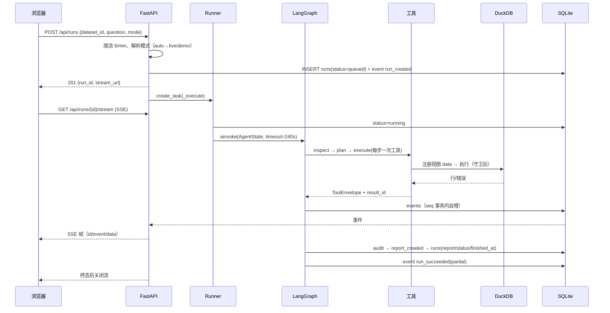
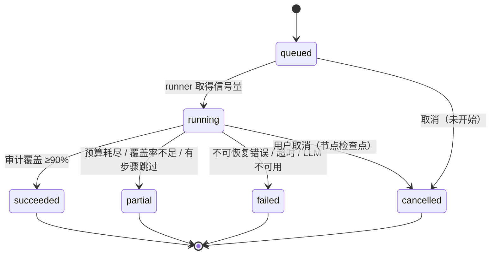

# 架构说明

> 面向“要改这个项目的人”：模块职责、一次请求的完整时序、状态机、错误码、以及如何加一个工具。

## 1. 模块职责

| 模块 | 文件 | 职责 | 不负责 |
|---|---|---|---|
| HTTP 装配 | `app/main.py` | 中间件（request_id / 计时）、异常处理、CORS、lifespan 自检、路由挂载 | 业务逻辑 |
| 配置 | `app/config.py` | 环境变量唯一读取点、派生路径、限额校验 | 运行时改配置 |
| 错误体系 | `app/errors.py` | `ErrorCode` 枚举、`AppError`、HTTP 状态映射、统一信封 | 展示文案 |
| 运行调度 | `app/runner.py` | 后台 task、`Semaphore(max_concurrent_runs)`、取消、超时、终态落库 | 节点内部逻辑 |
| 数据接入 | `app/services/loader.py` | 上传校验、编码探测、列名规范化、语义类型推断、质量剖析、读写 DataFrame | 分析计算 |
| 查询引擎 | `app/services/engine.py` | 每 run 独立 DuckDB 连接、执行隔离、超时中断、截断判定 | SQL 合法性（在 guard） |
| SQL 守卫 | `app/services/sql_guard.py` | sqlglot AST 白名单、表名/函数/系统对象校验、外层 LIMIT 包装 | 执行 |
| 指标计算 | `app/services/metrics.py` | 11 种 kind、filters、分组、growth_rate 口径 | 让模型参与算数 |
| 证据池 | `app/services/evidence.py` | `result_id` 生成与持久化、数值/表格递归提取 | 判定真伪（在 verifier） |
| 数字审计 | `app/services/verifier.py` | 声明值 vs 证据值、容差、逐 claim 判定 | 改写报告 |
| 图表 | `app/services/charts.py` | `ChartSpec` 构造校验、SVG 渲染（导出用） | 前端交互 |
| 报告装配 | `app/services/report_builder.py` | KPI/方法论/质量/降级/局限性 | 生成叙述 |
| 导出 | `app/services/exporter.py` | Jinja2 HTML/Markdown、artifact 落库、幂等复用 | 内容生成 |
| 存储 | `app/services/store.py` | SQLite schema、CRUD、事件 seq 事务内自增、重启清理 | 缓存 |
| LLM | `app/llm/*` | Protocol、OpenAI 兼容实现（退避重试）、Fake、提示词、工厂 | 业务决策 |
| Agent | `app/agent/*` | 状态、运行上下文、LangGraph 装配、11 个节点、7 个工具、Demo 规划器 | HTTP |
| 前端 | `frontend/src/*` | 四页面、SSE 接入、图表渲染、导出、状态完备 | 任何计算 |

## 2. 一次运行（创建 → 终态）



关键约束：

- **客户端断开不影响运行**：任务在 `RunManager.tasks` 里，SSE 只是订阅者。
- **事件顺序**：`events.seq` 在 `BEGIN IMMEDIATE` 事务里用 `MAX(seq)+1` 生成，无空洞。
- **中断语义**：进程重启时 `store.mark_interrupted_runs()` 把 `queued/running` 标成 `failed(RUN_INTERRUPTED)`，
  不做假恢复。

## 3. Run 状态机



`partial` 的判定优先级：审计覆盖率 <0.6、或二次重写仍 <0.9、或存在被跳过的步骤、或预算耗尽。

## 4. 错误码

| code | HTTP | 可重试 | 何时出现 |
|---|---|---|---|
| `VALIDATION_ERROR` | 400 | 否 | 参数不合法（附 fields） |
| `DATASET_NOT_FOUND` | 404 | 否 | 数据集不存在或已被删除 |
| `INVALID_COLUMN` | 400 | 否 | 列名不存在（附 available） |
| `RESULT_NOT_FOUND` | 404 | 否 | `from_result_id` 不在证据池 |
| `SQL_REJECTED` | 400 | 否 | 守卫拦截（附 reason/hint） |
| `SQL_EXECUTION_ERROR` | 400 | 是（语法类） | DuckDB 执行失败 |
| `TOOL_TIMEOUT` | 504 | 是 | 工具/查询超时 |
| `BUDGET_EXCEEDED` | 429 | 否 | 单 run 工具调用超限 |
| `EMPTY_RESULT` | 200(ok=false) | 是 | 查询无数据 |
| `INTERNAL_TOOL_ERROR` | 500 | 是 | 工具内未预期异常 |
| `UNSUPPORTED_FILE_TYPE` / `FILE_TOO_LARGE` / `DATASET_TOO_LARGE` / `INVALID_DATASET` | 415/413/413/400 | 否 | 上传校验 |
| `DATASET_IN_USE` | 409 | 否 | 删除仍被 run 引用的数据集 |
| `RUN_NOT_FOUND` / `RUN_ALREADY_FINISHED` / `RUN_TIMEOUT` / `RUN_INTERRUPTED` | 404/409/504/409 | — | 运行生命周期 |
| `REPORT_NOT_READY` | 409 | 否 | 报告未生成 |
| `LLM_NOT_CONFIGURED` / `LLM_UNAVAILABLE` / `LLM_INVALID_OUTPUT` | 409/503/502 | — | 模型配置/调用/输出 |
| `RATE_LIMITED` | 429 | 是 | 6 次/分钟限流（附 retry_after_s） |

所有错误响应统一为：

```json
{ "error": { "code": "...", "message": "面向用户的一句话", "details": { "hint": "..." }, "request_id": "req_..." } }
```

## 5. 扩展点：如何加一个工具（3 步）

以新增 `correlate_columns` 为例：

1. **写实现**：新建 `app/agent/tools/correlate_columns.py`，暴露
   `NAME / DESCRIPTION / Input(Pydantic, extra="forbid") / TIMEOUT_S / MAX_CALLS / PRODUCES_RESULT` 与
   `async def run(ctx: ToolContext, args: Input) -> ToolEnvelope`。
   - 需要算数就写到 `services/*.py`，工具只做参数校验与装配；
   - 产出表格/数值时设置 `PRODUCES_RESULT = True`（默认），由 registry 自动分配 `result_id`。
2. **注册**：在 `app/agent/tools/__init__.py` 与 `app/agent/registry.py` 的模块元组里各加一行。
3. **约束行为**：默认 `PLANNER_VISIBLE = True` 会出现在规划提示词里；若只在运行结束后可用（如导出），
   设 `PLANNER_VISIBLE = False`。补一个 `tests/test_tools.py` 用例（成功 / 参数非法 / 空结果）。

无需改图结构——计划的每一步只按 `tool` 名查注册表。
